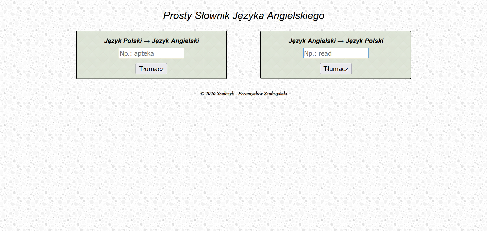
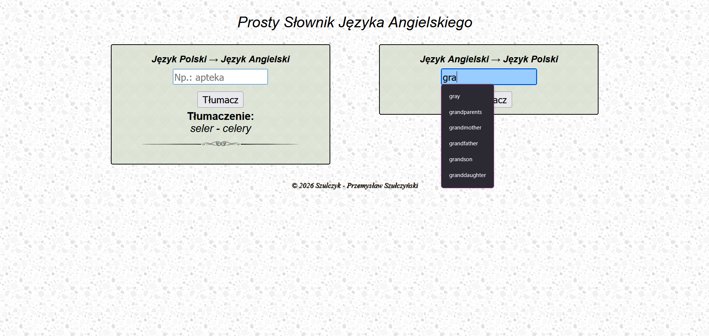
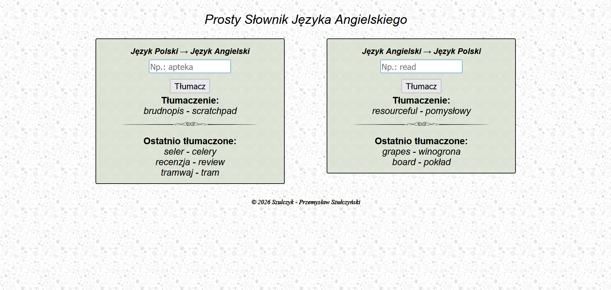
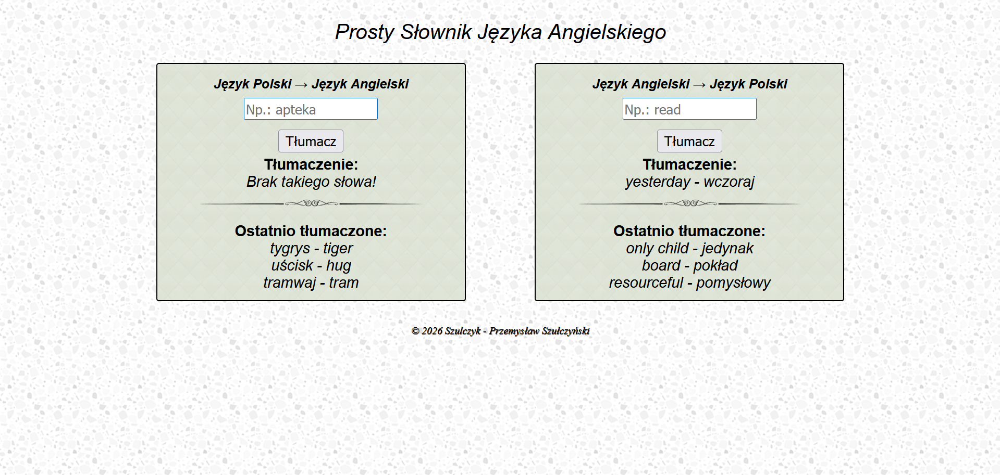

# ***[Projekt Język](https://szulczyk.pl/projekt-21/jezyk)***

## 🖼️ ***Zrzuty ekranu***

 

## 📄 ***Opis projektu***
### ✅ *Projekt zakończony dnia 24.02.2026*
### *Projekt jest dwukierunkowym słownikiem polsko-angielskim przeznaczonym do tłumaczenia pojedynczych słów. Użytkownik może z łatwością wpisać wyraz lub wybrać go z listy podpowiadanej w czasie rzeczywistym. Aplikacja automatycznie zapamiętuje ostatnio szukane pojęcia i wyświetla je na stronie głównej. W przypadku braku danego słowa w bazie system generuje jasny komunikat o jego nieobecności.*

 

## 🛠️ ***Stack projektu***
- ### *Frontend*
  - ### *HTML5*
  - ### *CSS3*
  - ### *JavaScript*
  - ### *AJAX*
- ### *Backend*
  - ### *PHP*
- ### *Bazy danych*
  - ### *XML*

 

## 📌 ***Podsumowanie projektu***
### 🎯 *Głównym celem projektu było stworzenie prostego słownika, który wykorzystuje zmienne sesyjne do zapamiętywania i wyświetlania historii przetłumaczonych słów. W ramach prac po raz pierwszy zastosowałem technikę AJAX, a także po raz kolejny utrwaliłem znajomość języka PHP w ramach walidacji wyrazów względem pliku XML, który został zastosowany jako baza danych.*
### 💡 *Czego się nauczyłem:*
- ### *Tworzenie i obsługa danych - opracowałem obszerny plik XML ze słownictwem i wykorzystałem go do walidacji w PHP oraz do generowania podpowiedzi w JavaScript.*
- ### *Dynamiczne pobieranie danych - po raz pierwszy zastosowałem technikę AJAX do dynamicznego wyświetlania podpowiedzi haseł w czasie rzeczywistym.*
- ### *Funkcjonalność sesji - zaimplementowałem mechanizm zapamiętywania wcześniej przetłumaczonych wyrazów, co wyróżnia aplikację na tle standardowych słowników.*
- ### *Dwukierunkowe tłumaczenie - umożliwiłem jednoczesne tłumaczenie w obu kierunkach z opcją bieżącego porównywania słów polskich i angielskich.*
- ### *Tworzenie elastycznego wyglądu - zaprojektowałem prosty oraz skondensowany interfejs aplikacji, zapewniając jej prawidłowe działanie na różnych urządzeniach.*

 

## 📨 ***Kontakt***
- ### 📧 *E-mail -* przemo.ppk@gmail.com
- ### 💻 *Discord -* darkcoder97